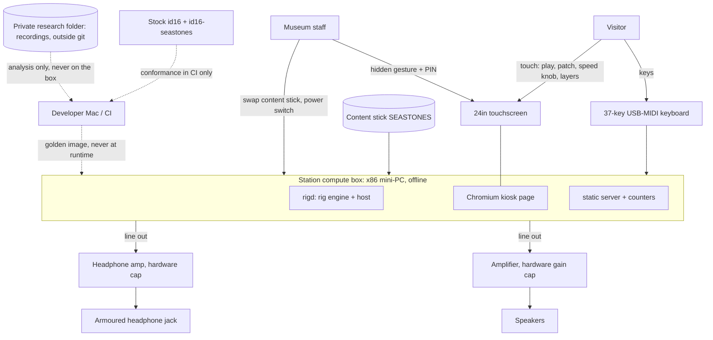
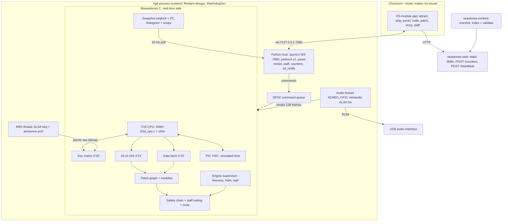
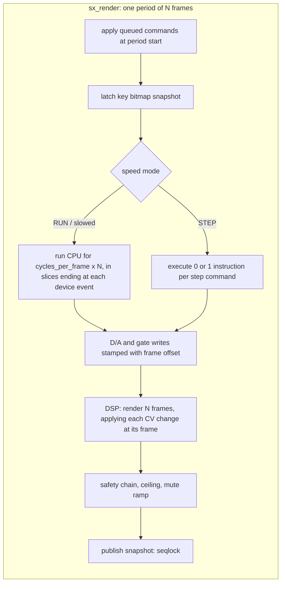
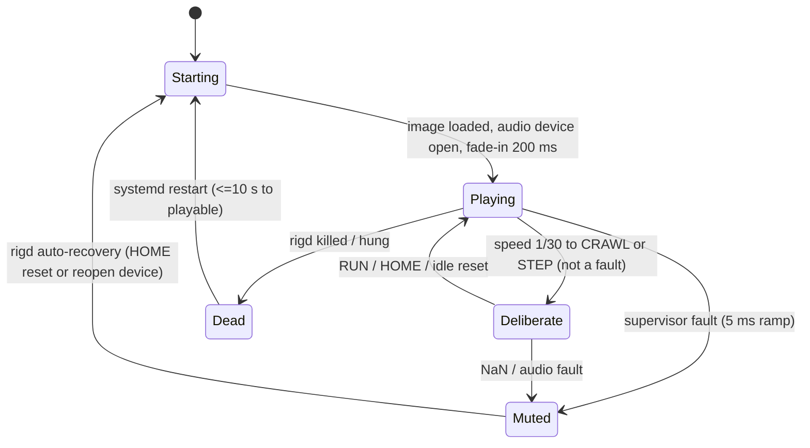
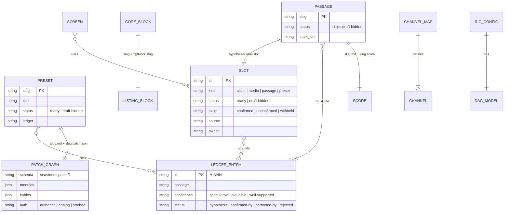
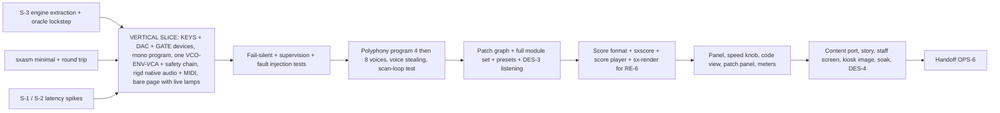

# The 1974 Seastones Rig — Software Architecture

**Version:** 0.2 · **Date:** 2026-10-31 · **Status:** Draft
**Author:** Nick D., with AI assistance
**Implements:** the project's product requirements (requirement IDs such as `KIOSK-1` are cited throughout; the planning documents that define them are not published)
**Reads with:** `docs/adr/001`–`010`; the museum's separate Model 4 kiosk platform, which this exhibit reuses (cited below as **M4-ARCH §n**).

> **Markers.** **[verified 2026-10-31]** means probed on Nick's Mac against `id16` V3.12-3 or
> read in the pinned open-simh source (`c0f0a88…`, tag `v3.12-3`, the Model 4 kiosk's pin).
> **[assumption]** means a default this document builds to until measured or overruled.
> **[spike S-n]** means it is decided by a measurement in §15 before more is built on it.
>
> **The headline decision changes the PRD.** The emulated CPU does **not** run as an `id16`
> process behind a console bridge (PRD MACH-1 as written). The CPU is **open-simh's own
> `id16_cpu.c`, compiled into a sample-clocked engine that also contains the D/A devices and the
> synthesizer**, running in one native real-time audio process. Stock `id16` becomes the
> conformance **oracle** in CI. §2 and ADR-001/002 give the reasoning; §17 lists every PRD line
> that has to change.

---

## 1. Executive summary

### 1.1 What the system is

One offline appliance: a 24″ touchscreen, an x86 mini-PC, a ~37-key USB-MIDI keyboard, speakers
with a headphone jack. Inside it, one process (`rigd`) contains **the rig engine**, a C library
that holds:

- an **Interdata 7/16 CPU**, which is SIMH's `id16` CPU source at the pinned tag with a small,
  documented patch set, clocked by the audio sample counter instead of by the host's wall clock;
- **three I/O devices we designed**: a key-matrix input port, a 16-channel D/A converter and a
  16-bit gate latch, written in C against SIMH's device interface;
- **the modular synthesizer**: oscillators, filters, VCAs, envelopes, LFOs, mixer and reverb as
  sample-accurate DSP, wired by a patch graph whose only control inputs are the D/A channels and
  gate lines;
- **the output safety chain** (DC block, 25 Hz high-pass, limiter, staff ceiling) as the last stage
  of the same render call, so no patch can get round it.

The keyboard sets bits in the key matrix. **Our 7/16 program**, written in Interdata assembly in
this repo, reads them with ordinary Interdata I/O instructions, allocates voices, and writes D/A
words. The words become control voltages, and the voltages play the synthesizer. Nothing else
can make a sound (D6).

Chromium in kiosk mode draws the visitor experience (attract, play, front panel, code view,
patch panel, story), and it makes no sound. It gets everything it shows from `rigd` over a loopback
WebSocket, and every lamp, meter and highlighted line comes from engine state.

### 1.2 Key architectural decisions

| # | Decision | Choice | Rejected | ADR |
|---|---|---|---|---|
| 1 | CPU emulation route | **SIMH's `id16` CPU source as a library inside the engine**, clocked from emulated time; stock `id16` as CI oracle | SIMH out-of-process + console bridge; a purpose-built core (Rust/TS) | 001 |
| 2 | Where the engine runs | **Native process `rigd`**: C engine + ALSA audio thread (SCHED_FIFO) + ALSA-sequencer MIDI, hosted by Python for control/WS | Browser AudioWorklet (WASM) | 002 |
| 3 | Device contract | Keys **X'20'**, D/A **X'21'**, gates **X'22'**; 16-bit MSB-justified unsigned D/A words, word size configurable (default 12) | reusing display device X'01' (milestone 1–2 stopgap only) | 003 |
| 4 | Toolchain | **Our own Python assembler** for the portable subset, cross-checked against SIMH's disassembler; **text score format** compiled to in-memory tables | the period Interdata assembler under SIMH (kept as a Could) | 004 |
| 5 | Audio engine | **All DSP in C in the engine**, sample-accurate D/A steps, selectable authenticity modes, safety chain last | Web Audio native node graph; AudioWorklet DSP | 005 |
| 6 | Kiosk runtime | **The Model 4 kiosk platform**: Debian + X11 + Chromium `--kiosk`, systemd units, overlayfs read-only root, `/data`, content stick, three-layer watchdog | Electron; Tauri | 006 |
| 7 | Content and patch data | Model 4 content system extended with presets, passages and a research ledger; preset = `.md` words + `.patch.json` graph; gated layer enforced in two places | one JSON file per preset holding visitor words | 007 |
| 8 | S-3 outcome | **GO**: route C stands; two SIMH patches, five vendored files, 430-line shim | amber; route B | 008 |
| 9 | Scan-loop budget | **Key-to-write latency limits** (one key ≤ 1 ms, chord ≤ 2 ms, all 37 ≤ 6 ms, pass ≤ 0.5 ms) met by a smarter scan (first-set-bit table, O(1) voices, ≤ 4 changes per pass) | relax the 1 ms period only; a hardware change latch | 009 |
| 10 | VCO band-limiting | **Table-driven minBLEP/minBLAMP at 1×**, deterministic kernel table, −60 dBc in 20 Hz–20 kHz | PolyBLEP (−35 dBc measured); oversampled PolyBLEP; mip-mapped wavetables | 010 |

### 1.3 Technology stack

| Layer | Technology |
|---|---|
| Rig engine | C17, vendored open-simh `Interdata/` files (pinned) + our devices + DSP; builds as `libseastones.so` (Linux) / `.dylib` (Mac dev) and as a CLI (`sx-render`) |
| Audio / MIDI I/O | miniaudio (vendored, single header) on ALSA `hw:` direct, no PipeWire/PulseAudio on the image; ALSA sequencer for MIDI (CoreMIDI backend for Mac dev) |
| Engine host and protocol | Python 3 (Debian's), `cffi` ABI mode, `websockets`; patterns ported from the Model 4 bridge |
| Web app | Static ES modules, no framework, no build step (M4-ARCH A-13); Canvas 2D for meters, cables and scope; SVG for the panel art |
| Static server, content tool | Ported from the Model 4 kiosk (`src/webserve/serve.py`, `src/content/tool/`) |
| Toolchain | Python 3: `sxasm` (7/16 assembler), `sxscore` (score compiler) |
| Oracle | Stock `id16` built from the pinned tag; `id16-seastones`, the same tag plus our device file |
| OS / platform | Debian 13 x86-64, X11, no desktop; systemd; overlayfs root; fanless x86 mini-PC |
| Research | Python notebooks (librosa/aubio, scipy) calling `sx-render` through a thin binding; audio outside git |

---

## 2. The CPU emulation route (design question 1)

This is the decision everything else depends on, so the whole argument is here. ADR-001 records it
formally and ADR-002 records the hosting choice.

### 2.1 What we know about `id16` (answers PRD R8 and the PLAN first task)

**[verified 2026-10-31]**, from the pinned source (`Interdata/id16_cpu.c`) and a live probe:

| Question | Answer |
|---|---|
| Is `set cpu 716` accepted? | **Yes.** `show cpu` then prints `CPU, idle disabled, 64KB, 7/16`. |
| Is `set cpu 7/16` accepted? | **No**, it gives `Non-existent parameter`. `7/16` is the MTAB *display* string; the match string is `716`. `I5`, `70`, `80` are also rejected. |
| What model does `id16` start in? | **7/16.** `cpu_unit` is initialised with `UNIT_716`, so the "Default config" Nick probed was already 7/16, and the Model 4 kiosk's `set cpu i4` is a move *down*. |
| What is "716" in SIMH? | One class covering **Model 5, 70, 80 and 7/16** (source comment: "I5/70/80/716"). SIMH does not distinguish them. |
| Instruction set vs I4 | 716 enables the **36-instruction "Model 5 group"** that I4 traps as illegal: `CHR CH`, short branches `BTBS BTFS BFBS BFFS`, short immediates `LIS LCS AIS SIS`, short shifts `SRLS SLLS`, `THI CHI CLB`, `AHM`, list processing `ATL ABL RTL RBL`, `EXBR`, `EPSR`, **halfword I/O `WHR RHR WH RH`**, `MHUR MHU`, `SVC`, `SINT`, and the full shifts/rotates `RRL RLL SRL SLL SRA SLA`. Both have the 61-instruction base, `AL LM STM`, and 13 single-precision floating-point instructions (microcoded, no guard digit, FP registers in memory). Neither has double precision (8/16) or memory extension (8/16E). |
| PSW | Mask **`FF0F`** (716) vs **`F40F`** (I4): 716 implements AIO `0800` (automatic I/O interrupt enable), SQI `0200` (system queue interrupt) and PRO `0100` (protect mode). This is the `FD00` vs `F400` difference the Model 74 test saw after BOSS's illegal-instruction trap. |
| Floating-point faults | With PSW FPF set, FP overflow swaps to the FP-fault PSW on 716; I4 does not (except divide with V and C). |
| Display device X'01' | In incremental mode the write position wraps **mod 8** on 716 (so the fifth byte reaches `DRX`) and mod 4 on I4. Otherwise identical. Note that `id16`'s display device follows the 1975 hexadecimal panel, not necessarily a 7/16's own panel (Model 74 HANDOFF). |
| Console interrupt | `set cpu consint` works only on 716/816. |
| **Instruction timing** | **None, in any model.** The CPU loop decrements `sim_interval` by 1 per instruction. `set throttle 50k` works and regulates instructions per wall-clock second in host-sized bursts. A 7/16's real speed cannot come from SIMH; it has to come from a cycle table we build from the manual (MACH-5, spike S-4). |
| Clocks | `PIC` (programmable interval clock, X'6C', 1/10/100/1000 µs ticks) and `LFC` (line-frequency clock, X'6D', 60 Hz) exist. Both calibrate against **host** real time (`sim_rtcn_calb`). |
| Our devices | X'20'–X'22' are free in the default configuration (PAS occupies X'10'–X'1F'). |

Real-hardware context: the 1973 7/16 brochure offers 1.0 µs and 750 ns core memory
([bitsavers](https://ftp.mirrorservice.org/sites/www.bitsavers.org/pdf/interdata/16bit/7-16/7-16_Brochure_1973.pdf)).
The per-instruction timing table has not been found yet (spike S-4). Until it is, the working
estimate is **about 250–450 k instructions/s**, labelled as an estimate.

### 2.2 The three routes

**A. SIMH out-of-process with a bridge** (PRD MACH-1 as written; PLAN.md). Fork open-simh, add
the devices in C, run `id16` as a child of a bridge (the Model 4 pattern), and ship D/A events over
IPC to the audio engine.

**B. A purpose-built in-process core.** Write a 7/16 CPU in Rust or TypeScript (WASM), run it in
an AudioWorklet or Worker, and test it against SIMH.

**C. SIMH's CPU source as a library inside the audio engine** (chosen; confirmed by S-3, ADR-008).
Vendor `id16_cpu.c`, `id_io.c`, `id_uvc.c` (PIC/LFC), `id16_sys.c` (the disassembler) and `id_fp.c`
(floating point, linked because the CPU calls it, although the subset excludes FP) from the pinned
tag. Replace SIMH's control program with a shim (planned ~300 lines; built at 430, ceiling 600). Clock it from the sample counter. Put it in the same
render call as the devices and the synthesizer.

### 2.3 Weighing them

| Criterion | A: `id16` process + bridge | B: own core | **C: SIMH CPU in the engine** |
|---|---|---|---|
| **25 ms p95 key→sound** (NFR-1) | Key → bridge → device IPC → throttled burst → D/A IPC → audio. SIMH 3.12's throttle runs in host-sized bursts and sleeps, so D/A writes arrive in clumps. Holding NFR-2's ≤5 ms jitter means timestamping every write and replaying it with a fixed delay at least as long as a burst, which spends most of the budget. Feasible only with heavy SCP surgery. | Excellent (same process as audio) | **Excellent**: key bitmap read at each 2.67 ms period; D/A write effective at its exact sample (§6) |
| **Deterministic timing** | No: host-throttled; differs run to run | Yes | **Yes, bit-exact.** Output is a pure function of image + config + timestamped input. Golden-render tests and offline research renders (RE-6) come for free |
| **Speed knob / single-step** (PLAY-7, PANEL-2) | `set throttle` needs Ctrl-E / `cont`. The Model 4 work found SIMH drops console input for seconds after `cont`. Single-step works but is a console round trip per lamp read | Trivial | **Trivial and exact**: cycles-per-sample is a number; STEP is "execute one instruction at the next period" |
| **Lamps ≥30 Hz, live disassembly, code view** | SIMH 3.x must be stopped to `ex`. The Model 4 kiosk never free-runs for this reason (M4-ARCH §1 fact 3), which quantises D/A timing to its batch tick | Must write a disassembler | **Engine snapshot at 60 Hz** (registers, PSW, DR/SR, PC histogram, watched memory); **SIMH's own `fprint_sym`** compiled in, so the code view's disassembly is SIMH's text |
| **Fidelity to the 7/16 ISA** | SIMH's | Ours to get right: ~100 instructions × condition codes × PSW swaps × I/O semantics; real risk of subtle CC bugs | **SIMH's**: the same 2,000 lines, maintained since 2000. Our patches are clocking and timing only, and stock `id16` checks them instruction by instruction |
| **Kiosk robustness** | Three processes and two IPC links, console-port hygiene (M4-ARCH §5.1 needed PDEATHSIG, pidfiles, SO_LINGER, port reservation), the #56 telnet-on-LAN issue | One process | **One process, no console, no ports except the loopback WS.** CPU and sound share fate: if either dies, both are silent (MACH-7) |
| **Fail-silent ≤100 ms** | Needs a cross-process watchdog | Native | **Native**: §8 |
| **Phase 2** | `id16` can't drive a USB D/A without the same IPC | Possible | The device spec is a hardware contract (§5). The engine has a **D/A event sink seam** that a later host forwards to a USB D/A (P2-3). The engine also runs headless (`sx-render`) |
| **PRD letter (MACH-1)** | Matches | Breaks: "no hand-written CPU model" | **Changes the letter, keeps the intent**: real SIMH CPU code at a pinned commit, the program really executes, nothing imitated. §17 |
| **Effort** | High (SCP surgery, IPC, bridge port) | High (CPU + disassembler + debugging) | **Moderate**: SCP surface used by these files is small (`sim_interval`, `sim_process_event`, `sim_activate/cancel`, `sim_brk_*`, `sim_printf`, `sim_idle`, `sim_rtcn_*`, `sim_devices`) **[verified 2026-10-31]** |

**Choice: C.** It is the only route that meets NFR-1, NFR-2, PLAY-7 and the code view together
without rebuilding SIMH's control program. It also keeps the fidelity argument that made SIMH
attractive in the first place.

### 2.4 How SIMH is still used

1. **As the CPU.** The vendored files are byte-identical to the pin except for the patches in
   `src/engine/simh/patches/`, each one small and named (§4.2). `src/engine/simh/PROVENANCE.md`
   records the tag, commit, file hashes and the licence notice (RIGHTS-7, OPS-7).
2. **As the conformance oracle (CI).** Stock `id16` built from the same pin (the Model 4 kiosk's
   `build-simh.sh` pattern) runs the same programs. With `set cpu history=65536` and `show history`,
   the two are compared instruction by instruction: PC, IR, R1, effective address, operand, CC.
   This runs on random instruction streams restricted to the portable subset, on SIMH-runnable
   period code (the "LIGHT DISPLAY FOR M-70" tape, `lamps.ini`), and on our program with the
   devices stubbed (§14.2).
3. **As the device oracle.** `id16-seastones` is the same tag plus **the identical device source
   file** (`src/engine/devices/id_seastones.c`) and a three-line patch to `id16_sys.c`/`id_defs.h`.
   Given the same key-input schedule (keyed by instruction count), its D/A write trace must equal the
   engine's exactly. This is the "fork open-simh and add devices" route, built small and kept as a
   test instrument and a Phase 2 reference rather than as the runtime.
4. **As the disassembly check.** For every word of the shipped image, the engine's `fprint_sym`
   output must equal `ex -m` from stock `id16` (CODE-3's proof that the listing is what is in memory).
5. **As a bench tool.** Developers can load the image into `id16-seastones` and poke it at the
   `sim>` prompt. Nothing on the floor runs it.

### 2.5 Risks (CPU route)

- **R-A1, shim fidelity.** SIMH files assume SCP's event queue and its stop semantics. *Mitigation:*
  the oracle lockstep in CI covers every instruction in the subset, including PSW swaps and wait
  state. The shim is small enough to review in one sitting. Spike S-3 extracts and runs it first.
- **R-A2, a cycle table we invented.** SIMH has no timing, so "authentic speed" rests on our table.
  *Mitigation:* source it from the 7/16 processor manual (S-4). Until then label it an estimate
  (MACH-5's ±10% AC is against *our* calculation, which is honest only if the table is cited).
- **R-A3, single instance.** SIMH keeps CPU state in globals, so there is one engine per process.
  Acceptable: tests that need two machines run two processes.

---

## 3. System context



| External | Purpose | Integration |
|---|---|---|
| USB-MIDI keyboard | Physical input (INPUT-1) | ALSA sequencer, class-compliant USB-MIDI |
| Touchscreen | Display + touch (INPUT-2) | X11, `xinput` mapping (M4-ARCH §9.3) |
| USB audio interface → amps | Sound (AUDIO-3) | ALSA `hw:` direct, 48 kHz |
| Content stick `SEASTONES` | Words, presets, passages, config (CONT-7) | ro mount, indexer at boot (M4-ARCH §7.3) |
| Open-simh (pinned) | CPU source + oracle | Vendored files; CI build of stock `id16` |
| Private research folder | RE workstream | `SEASTONES_AUDIO_DIR`; never in the repo or on the station |

| Actor | Interactions |
|---|---|
| Visitor (Maya, Ray, Dana, groups) | Keyboard, on-screen keyboard, layers 1–5 (6 when cleared) |
| Docent / operator | Power, HOME, staff screen (volume, quiet hours, restart, review mode, save preset, counters) |
| Content editor | Content stick text files, validator |
| Developer (Nick + team) | Build, image, oracle, research; after handoff a courtesy only |

---

## 4. Component architecture

### 4.1 Runtime map



Process and unit list (names follow the Model 4 kiosk so the runbooks read alike):

| Unit | What | Restart | Reused from |
|---|---|---|---|
| `seastones-content.service` | oneshot at boot: index + validate content stick → `/data/content/index.json` | — (always exits 0) | M4 `model4-content` |
| `seastones-web.service` | static server, `POST /counters`, `POST /heartbeat`, COOP/COEP not needed | `always` | M4 `serve.py` |
| `seastones-rigd.service` | engine host | `always`, `RestartSec=1`, `WatchdogSec=5` | M4 bridge *patterns* (protocol, heartbeat, single writer) |
| `.xinitrc` loop → `kiosk.sh` → Chromium | page | loop, ~3 s | M4 verbatim |
| `seastones-watchdog.timer` | page-heartbeat staleness → `pkill chromium` | timer | M4 verbatim |
| `seastones-reset.timer` | nightly clean restart, 03:30 + random delay | timer | M4 verbatim |
| systemd `RuntimeWatchdogSec=60` | `/dev/watchdog`, full hang → reboot | kernel | M4 verbatim |

**Why the page is not served by `rigd`:** same reasoning as M4-ARCH §3.3. `rigd` is the
complicated process, and a reload against a dead origin would put Chromium's error page on the
glass.

### 4.2 The rig engine (`src/engine/`, C)



**Clocking.** Emulated time is kept in CPU cycles of `cycle_ns` (default 250 ns, a quarter of
core memory cycle time, so instruction costs are integers). A period of N frames at 48 kHz is
N × 20 833 ns of emulated time at RUN speed. The speed setting divides that. The shim's
`sim_process_event` runs a tiny cycle-keyed event queue (PIC ticks, our step-stop event).
`sim_rtcn_calb` is replaced by a constant derived from emulated time, so **PIC and LFC tick in
emulated time** and slow down with the speed knob, along with everything else the computer does.

**The SIMH patch set** (`src/engine/simh/patches/`, kept as small as possible and listed in
`PROVENANCE.md`). **Two patches** (S-3, ADR-008):

| Patch | File | Change |
|---|---|---|
| `0001-cycle-cost` | `id16_cpu.c` | the interval decrement moves from before the fetch to just after decode and costs `SX_CYC(op)` from our table (`cycles.c`, generated from `tools/cycles/cycles-716.tsv`) instead of 1; with unit cost it is identical to stock |
| `0004-devices` | `id16_sys.c` | under `SEASTONES_ENGINE`, `sim_devices` lists only CPU (with its display), selector channel, PIC, LFC and our KEYS, DAC, GATE; the binary loader returns "no function", so no peripheral source is linked. Stock builds are unchanged |

Numbers 0002 (emulated RTC) and 0003 (idle in engine) are **retired**: `id_uvc.c` calibrates only
through `sim_rtcn_init`/`sim_rtcn_calb` and the wait state only calls `sim_idle`, so the shim
implements all three on emulated time and those files stay byte-identical to the pin. The shim
therefore owns clock and idle semantics, and has its own tests (SP-S3E, CNF-11).

Nothing touches instruction semantics. The oracle (§2.4) is what holds that line.

**Device set inside the engine:** CPU, PIC, LFC, KEYS, DAC, GATE, and the display device X'01'
(it lives in `id16_cpu.c` anyway; its `DR`/`SR` are the panel lamps and switches). The selector
channel device is registered because `id_io.c` defines it, but nothing uses it. The Teletype,
disks and tapes are **not** included. The program needs none of them, and
leaving them out removes their SCP dependencies.

**Real-time rules for `sx_render`** (non-negotiable, enforced by review and an `RT_SAFE` lint
pass that forbids `malloc`/`free`/locks/syscalls in `render/`):

1. No allocation, no locks, no syscalls, no logging in the render path. Commands arrive through a
   bounded single-producer/single-consumer ring. Snapshots leave through a seqlock.
2. Bounded work per period: at the fastest speed setting the CPU budget is capped (RUN is the
   fastest; there is no "turbo"). A period always completes.
3. Every float output is checked. NaN/Inf resets the offending module's state and raises a fault
   flag (§8).

### 4.3 The C API (the contract between engine and host)

```c
/* src/engine/include/seastones.h  (excerpt; full header is the contract) */
typedef struct sx_engine sx_engine;

sx_engine *sx_create(const sx_config *cfg);          /* sample rate, D/A model, channel map,
                                                         cycle table, memory size (32 KB) */
void  sx_destroy(sx_engine *);
int   sx_load_image(sx_engine *, const sx_image *);   /* deposit segments, set PC/PSW; non-RT */
void  sx_render(sx_engine *, float *out_lr, uint32_t frames);   /* RT thread only */

/* any thread, lock-free */
void  sx_keys_set(sx_engine *, sx_key_source src, uint64_t bits); /* MIDI, TOUCH, DEV_QWERTY */
int   sx_command(sx_engine *, const sx_cmd *);        /* SPEED, STEP, RUN, HALT, RESET_HOME,
                                                         SR_SET, DEPOSIT_TABLE, PATCH_*, CEILING,
                                                         MUTE, AUTH_MODE ... returns -EAGAIN if full */
int   sx_snapshot_read(sx_engine *, sx_snapshot *out); /* seqlock copy; see §4.4. Named _read
                                                         because C forbids a function and a
                                                         typedef sharing the name (ADR-008) */
size_t sx_disasm(sx_engine *, uint16_t addr, char *buf, size_t n); /* SIMH fprint_sym; non-RT */

/* Phase 2 seam (P2-3): not implemented in v1 beyond a null sink */
typedef void (*sx_io_sink)(void *ctx, uint64_t emu_cycle, uint8_t dev, uint8_t ch, uint16_t val);
void  sx_set_io_sink(sx_engine *, sx_io_sink, void *ctx);
```

### 4.4 The snapshot (what the UI may show)

Published every period into a seqlock. `rigd` samples it at 60 Hz and the UI renders at up to 60 fps.

| Field | Source | Shown as |
|---|---|---|
| `pc`, `psw`, `r[16]`, `cc` | CPU | panel lamps, code view highlight, register strip |
| `dr`, `drx`, `sr` | display device | panel lamps, switches |
| `keys_raw[8]` | key bitmap as offered to the device | staff diagnostics only |
| `keys_seen[8]` | **the last value the program actually read from each row** | PLAY-3 "keys the program has seen" |
| `dac[16]` (code + volts) | D/A latches after word-size truncation | PLAY-3 meters, patch-panel jack glow |
| `gates` | gate latch | gate lamps |
| `watch[]` | memory words at addresses named in the listing (voice table, score pointer) | "which voice each note got", "the score table being read" (MACH-8) |
| `pc_hist[]` | instruction-count histogram per listing line over the last 250 ms | CODE-1 heat band |
| `scope[512]` | decimated output | AUDIO-6 |
| `speed`, `halted`, `waiting`, `cycles` | engine | panel, staff |
| `faults`, `muted`, `xruns`, `frames` | supervisor | error state, staff health |
| `lat_hist` | internal key→first-D/A-write latency histogram (emulated + period wait) | staff health, counters (NFR-1 field monitoring) |

**Honesty rule (from M4-ARCH §5.5):** the UI derives nothing. With the engine halted, no
display that PLAY-3 lists can change when a key is pressed, because `keys_raw` is the only field
that moves and it is staff-only. A Playwright test asserts it (PLAY-3 AC).

### 4.5 `rigd` host (`src/rigd/`, Python)

- Loads `libseastones` through `cffi` (ABI mode: no compiler on the station).
- Owns the audio device and MIDI threads through engine-side C helpers (`src/host/`), so no Python
  code runs on a real-time thread, ever.
- **Panel model** (`panel.py`): which engine fields each drawn lamp shows, in which mode, published
  with a `src` provenance string (M4-ARCH A-6 pattern), driven by `content/rig/panel.md` because
  the 7/16 panel layout is not yet verified (PANEL-1, R7).
- **Session model**: speed position, layer-independent reset (HOME, idle), preset loading, passage
  loading (with the SEA-3 gate check, §11.4), staff settings persisted to `/data/staff.conf`.
- **Protocol v1** over `ws://127.0.0.1:7690` (§4.6). One writer to the engine command queue.
- **Supervision**: `sd_notify(WATCHDOG=1)` only while the engine's `frames` counter is advancing
  and the asyncio loop is responsive. `PR_SET_PDEATHSIG` is not needed because there is no child process.
- **No page, no sound**: if no UI client has been connected for `ui_absent_mute_s` (default 10 s),
  `rigd` mutes the engine. A headless exhibit could not show the disclosure (STORY-3) or an error
  state (KIOSK-4).

### 4.6 WebSocket protocol v1 (UI ↔ `rigd`)

JSON messages, `{"v":1,"t":<type>,...}`, the Model 4 kiosk's `ack`/`nack` and `heartbeat`
conventions (M4-ARCH §5.6), with the schemas kept by hand in `src/rigd/schema/` and asserted in
dev.

| Direction | Type | Payload (abridged) |
|---|---|---|
| S→C | `hello` | protocol version, engine build hash, image hash, capabilities (speed positions, modules, D/A model, channel map, listing id) |
| S→C | `state` (60 Hz) | §4.4 fields, `seq` |
| S→C | `scope` (30 Hz) | 512 floats |
| S→C | `heartbeat` (1 Hz) | `engine_alive`, `audio_ok`, `midi_present`, `faults[]`, `muted`, `lat_p95` |
| S→C | `fault` | `code`, `staff_line`, `since` (codes §8.2) |
| C→S | `keys.touch` | 64-bit bitmap (the on-screen keyboard's whole state, not edges: a lost message cannot stick a note) |
| C→S | `machine.speed` / `machine.step` / `machine.home` / `machine.sr` | position id / — / — / bounded SR value (PANEL-4) |
| C→S | `patch.connect` / `patch.disconnect` / `patch.param` / `patch.load` | jack ids / jack ids / module, param, value / preset slug |
| C→S | `passage.start` / `passage.stop` | slug (refused unless `ready` or review mode) |
| C→S | `staff.*` | PIN-gated: `ceiling`, `quiet_hours`, `idle_timeout`, `attract_sound`, `restart`, `review_mode`, `save_preset` |
| S→C | `ack` / `nack` | correlation id; nack codes `bad_args`, `refused_gate`, `busy`, `not_staff`, `queue_full`, `unknown` |

Touch keyboard state is sent as **level, not edge**, at every change plus a 4 Hz refresh. If the
page dies, `rigd` clears the touch source 250 ms after the socket closes (INPUT-4).

### 4.7 Web app (`src/web/`)

No framework, no build step (M4-ARCH A-13). Modules:

| Module | Owns | PRD |
|---|---|---|
| `app.js` | wiring, config, layer lifecycle | — |
| `layers.js` | layer 0–6 model; HOME; idle → attract; layer 6 present only if the index has a `ready` passage | §4.1, PLAY-8, PLAY-9, SEA-3 |
| `rig.js` | WS client: backoff, heartbeat deadline, ack correlation | KIOSK-2 |
| `keyboard.js` | on-screen keyboard → `keys.touch` level messages; QWERTY dev mapping | INPUT-2, INPUT-5 |
| `touch.js` | Pointer Events normalisation, multi-touch per key, gesture suppression (ported from M4) | INPUT-4 |
| `panel.js` | front panel renderer, a pure function of `state` + `panel` model | PANEL-1–3 |
| `speed.js` | speed knob control | PLAY-7, PANEL-2 |
| `code.js` | listing view, highlight from `pc`, heat band from `pc_hist`, block notes from content, disassembly column (staff/expert) | CODE-1–4 |
| `patch.js` | jacks, cable drag with droop, hit-testing, "Put it back", silence hint | PATCH-1, -4, -7 |
| `meters.js`, `scope.js` | D/A meters, gate lamps, voice map, scope (Canvas 2D, ≤3 Hz large-area change rule) | PLAY-3, AUDIO-6, NFR-10 |
| `content.js`, `blocks.js`, `templates.js`, `strings.js` | ported from M4 | CONT-*, STORY-* |
| `errors.js` | error state, staff line | KIOSK-4, -5 |
| `staff.js`, `diag.js` | staff screen (gesture + PIN), diagnostics | STAFF-* |
| `counters.js` | batched `POST /counters` | KIOSK-7 |

The **disclosure footer** is rendered by the layer shell, outside every layer's container, so no
layer can omit it (STORY-3 AC). The validator checks its text is present (CONT-5).

---

## 5. The device contract (MACH-2, MACH-3, P2-2)

This section is the device specification MACH-2's AC asks for. It is written as a **hardware
contract**: a Phase 2 interface board on a Model 74 can implement it byte for byte. Everything
here is **our choice, not Lagin's**, and the exhibit says so (PATCH-7). ADR-003 has the reasoning.

All three devices use standard Interdata programmed I/O: select by device number in a register
(`OCR`/`WHR`/`RDR` etc. address the device in R1, data in R2), no interrupts, no selector channel,
no automatic I/O. Status follows Interdata convention: `BSY` 0x8, `EX` 0x4, `EOM` 0x2, `DU` 0x1.

### 5.1 KEYS: key-matrix input port, device X'20'

- **Matrix:** 8 rows × 8 keys = 64 key positions. Key *k* is row `k >> 3`, bit `7 − (k & 7)`
  (Interdata bit 0 is the MSB). The 37-key keyboard occupies keys 0–36. The on-screen keyboard maps
  to the same key numbers.
- **OC (output command) byte:** bits 5–7 = row select (0–7); `0x40` = auto-advance (each read
  moves to the next row, wrapping 7→0); `0x80` = normal (no advance).
- **RD (read data, byte):** returns the selected row, 1 = key down, as the device sees it **at that
  emulated instant**. The device records the value returned per row in `keys_seen`.
- **RH (read halfword):** returns two consecutive rows (row *n* in the high byte), then advances by
  two in auto-advance mode. 7/16 and Model 74 only.
- **SS (sense status):** 0 normally; `DU` if no key source has ever been attached (staff diagnostic;
  never seen in practice because touch is always attached).
- **Electrical meaning (Phase 2):** a parallel input port reading a diode-isolated matrix whose row
  drive is the OC row select. No debouncing in hardware. The program may debounce.
- **Sources:** MIDI and touch are separate 64-bit bitmaps, ORed. Velocity is ignored (INPUT-1). A
  vanished MIDI port clears its bitmap at once (§8).

### 5.2 DAC: 16-channel D/A converter, device X'21'

- **OC byte:** bits 4–7 = channel select (0–15); `0x40` = auto-increment channel after each write
  (wrapping 15→0); `0x80` = normal.
- **WH (write halfword):** a **16-bit unsigned, MSB-justified** code to the selected channel. The
  converter keeps the top *N* bits, where *N* = `dac.word_bits` (default **12**) and the rest are
  ignored, exactly as a 12-bit converter wired to the top of a 16-bit bus would behave. The output
  latches until the next write to that channel. **WD (write byte)** writes the high byte and clears
  the low byte (an 8-bit path for programs that want it).
- **Timing:** a write takes effect at the emulated cycle of the instruction's completion, rendered
  at the corresponding audio frame (§6). Settling time is modelled by the authenticity mode (§6.4).
- **SS:** 0 (never busy). A real board that needs settling time may assert `BSY`; the program
  tests SS before each write only if `dac.honour_busy` is set (off in v1, on for Phase 2).
- **Voltage:** `V = (code >> (16 − N)) × dac.range_v / 2^N`, default range **0 to +10.24 V**
  (so 12-bit LSB = 2.5 mV = **3.0 cents** at 1 V/octave; 8-bit LSB = 40 mV = 48 cents).
  Both defaults are **hypotheses** to be tested by RE-7 Q2 and labelled as such (MACH-3, RE-9).

### 5.3 GATE: 16-bit gate latch, device X'22'

- **Bit numbering:** Interdata convention, as for KEYS (§5.1): **bit 0 is the most significant
  bit**. Gate line *i* is bit *i*, mask `0x8000 >> i`.
- **WH:** 16 bits, bit *i* drives gate line *i* (1 = high, +5 V). Latched.
- **WD:** writes bits 0–7 (the **high byte**: byte bit 0, mask `0x80`, is gate line 0) and leaves
  lines 8–15 alone. This matches the DAC, where `WD` also lands in the high byte, and it means the
  eight voice gates of the default map (lines 0–7, §5.4) change with a single `WD`.
- Power-on and HOME reset clear all 16 lines.
- Example: `WHR R1,R2` with R1 = X'22' and R2 = X'8000' raises gate 0 only; R2 = X'0001' raises
  gate 15 only.
  (Confirmed 2026-10-31, ADR-003 amendment; the engine lane had built it this way when this section was
  silent.)
- **Why it exists:** Lagin's own description says 16 D/A channels controlled *all* of the E-mu's
  functions, so his gates may have come from D/A channels. Sixteen channels cannot carry eight
  voices' pitch **and** gate **and** any modulation, which PLAY-4's 8-voice Should needs. A gate
  latch is a cheap, period-plausible digital output. It is labelled as our choice, and an
  **all-D/A channel map** (gates from D/A channels through a threshold) ships as an alternative
  map so the hypothesis can be tried by ear (RE-7).

### 5.4 Default channel map (data, `content/rig/channel-map.md`; RETRO-1)

| Lines | Default use (8-voice map) | All-D/A alternative (4-voice map) |
|---|---|---|
| D/A 0–7 | pitch, voices 0–7 (1 V/oct) | 0–3 pitch, 4–7 gate/level (gate if > 2.5 V) |
| D/A 8–11 | computer modulation lanes A–D (sweeps, stepped filter, rhythm CV) | per-voice timbre |
| D/A 12–15 | score/rhythm lanes E–H | global modulation |
| Gate 0–7 | voice gates | unused |
| Gate 8–15 | rhythm triggers | unused |

The program reads its channel assignments from a table assembled from this file, so a confirmed
map from someone who worked on the original means one data edit and a rebuild of the image. The engine and UI need no
code change.

### 5.5 Program memory map (32 KB machine; the program fits in 8 KB for Phase 2)

| Range | Use |
|---|---|
| X'0000'–X'007F' | PSW swap areas, reserved low core |
| X'0080'–X'0FFF' | program code (entry X'0080') |
| X'1000'–X'10FF' | pitch table: note → 16-bit code (128 entries) |
| X'1100'–X'11FF' | channel-map table, voice table (8 × state, free list, age queue), key→voice map (64 bytes), key history |
| X'1200'–X'12FF' | first-set-bit table, 256 bytes (scan loop, ADR-009) |
| X'1300'–X'1FFF' | variables, attract pattern, built-in "Computer rhythm" tables |
| X'2000'–X'7FFF' | score area: one loaded score table ("the tape") |

**Switch register** (sanctioned visitor/host input, PANEL-4): bits 0–3 mode (0 play, 1 score,
2 play + score), bits 4–7 transpose (signed semitones), bits 8–15 reserved. `rigd` bounds-checks
every SR write. Free memory deposit by visitors is a Won't.

### 5.6 The program (outline; MACH-4, PLAY-4)

```
INIT   clear gates, D/A codes to rest values, voice table empty (all voices on the free list),
       PIC to 1 ms ticks
LOOP   *@block read-the-keys     OC KEYS auto-advance; 5 × RD (37 keys)
       *@block what-changed      XOR with previous rows; unchanged rows cost one branch;
                                 for a changed row, LB the first-set-bit table to get one key,
                                 clear that bit, repeat while changes remain and count < K (= 4)
       *@block find-a-voice      press: pop the free list, else steal the head of the age queue
                                 (documented order); release: key→voice map, push voice free. O(1)
       *@block write-to-the-synth  WH pitch (table lookup + transpose) per key; gate image
                                 written once per pass with WD (voice gates are lines 0–7)
       *@block play-the-score    if SR mode ≥ 1 and PIC tick elapsed: step score records
       *@block go-round-again    B LOOP
```

**Design constraint (ADR-009; replaces v0.1's "worst-case loop period ≤ 1.0 ms").** What a visitor
feels is the time from a key going down to that key's pitch and gate being written, so the limits are
on that, in **emulated time at RUN**, from the KEYS bitmap change (the period-start latch) to the
completion of the key's pitch **and** gate writes (a release: its gate write), with the score active
and every voice busy:

| ID | Case | Limit | Design estimate (`ESTIMATE` table) | NFR-1 consequence (§6.6) |
|---|---|---|---|---|
| L1 | one key changes | ≤ 1.0 ms | ≈ 0.25 ms | p95 budget unchanged at 16.2 ms |
| L8 | up to 8 keys at once | every key ≤ 2.0 ms | ≈ 0.95 ms | last chord note ≤ 17.2 ms |
| L37 | all 37 keys at once | every key ≤ 6.0 ms; none lost; first ≤ 1.0 ms | ≈ 4.0 ms | every key ≤ 21.2 ms |
| P | any single pass | ≤ 0.5 ms (idle ≤ 0.15 ms) | ≈ 0.42 ms max; 67–100 µs idle | score tick jitter under one 1 ms tick |

A straightforward loop (linear voice search, 8-bit walk per changed row) measured 2.0 ms for an 8-note
chord and 5.2–8.1 ms for all 37 keys against the S-4B table, which is why the program uses the
first-set-bit table, O(1) voices and the `K` cap. PRG-01 asserts the four limits from device-event
timestamps; PO-13 replaces the estimates with `cycle-calc` output and then engine measurements. Polled
I/O only, with no interrupts, so the same program runs on a Model 74 without an interrupt structure
(MACH-6).

### 5.7 The portable instruction subset (MACH-6, P2-1)

`src/program/subset/m74-portable-1.txt`, **90 instructions**: SIMH's 716 class (113) **minus** all
floating point (13; Model 74 has none), **minus** list processing `ATL ABL RTL RBL`, **minus** block
I/O `WBR RBR WB RB` (removed by S-5: 29-261R01 App. 1 and 2 mark Read/Write Block "Models 70, 80
only"), **minus** `SVC SINT` (the 74 has them; left out by our design choice, to avoid depending on a
Model 74 interrupt configuration we have not verified), and the program uses no auto-I/O or PSW
AIO/SQI/PRO features. Source: 29-261R01 App. 1 (pp. A1-1 to A1-4) and App. 2, read from OCR; **pending
Nick's read of the scan** (HUM-22; `docs/qa/results/M1/S5.md` lists the open points, including the
block-I/O rows in the A5 timing table). The program needs only polled halfword and byte I/O, so the
block-I/O question costs nothing either way. The assembler refuses any mnemonic outside the active
subset file (§9.2). The S-3 lockstep streams still exercise the four block-I/O instructions as
"oracle-only" (`tests/conformance/test_lockstep.py`): a superset of the program's subset, which is harmless.

---

## 6. Audio engine (design question 3)

### 6.1 Where the DSP runs

In the engine, in C, in the same `sx_render` call as the CPU (ADR-005). The Web Audio options were
weighed and rejected:

| Option | Why not |
|---|---|
| Web Audio native graph (OscillatorNode `detune` as 1 V/oct, BiquadFilter, GainNode) | No gate-driven envelope; weak resonant filter character (fails DES-3 for a modular voice); main-thread `setValueAtTime` scheduling adds jitter; Chromium's Linux output latency is a measured unknown on our budget's critical path; autoplay and Web MIDI permission policies in kiosk mode |
| AudioWorklet DSP (WASM) | Would work, and was the runner-up. It loses on output-latency control (Chromium's audio stack on Linux), on fate-sharing with renderer reloads (AUDIO-4 thumps on every reload), and on input path (Web MIDI is main-thread only, so MIDI would cross the jankiest thread). The engine stays portable C, so a WASM build remains possible for KIOSK-9 (§13) |

### 6.2 Modules (PATCH-2)

Each module is a C struct with declared ports and parameter ranges. The registry is exported at
build to `build/modules.json`, the single source of truth for the UI, the validator and the patch
schema.

| Module | Inputs | Outputs | Notes |
|---|---|---|---|
| `vco` | `pitch` (1 V/oct), `fm` (lin), `pw` | `sine tri saw pulse` | table-driven **minBLEP** (saw, pulse) and **minBLAMP** (triangle) at 1×, deterministic `sx_exp2` and polynomial sine, aliasing ≤ −60 dBc in 20 Hz–20 kHz (NFR-6, DSP-08; ADR-010); `tune` (0 V = C0 16.352 Hz by default), `fine` |
| `noise` | — | `white pink` | |
| `vcf` | `in`, `cutoff` (1 V/oct), `res` | `lp` (4-pole), `hp`, `bp` (2-pole) (S) | ZDF ladder with tanh stages, 2× oversampled; resonance clamped below the runaway limit (AUDIO-2) |
| `vca` | `in`, `cv` (0–10 V, lin/exp) | `out` | **0.5 ms declick on `cv`** (a real VCA's finite slew; stops D/A steps on amplitude from clicking past NFR-6) |
| `env` | `gate` (threshold 2.5 V), `retrig` | `out` (0–10 V) | ADSR and AR modes |
| `lfo` | `rate` (1 V/oct) | `sine tri square sh` | |
| `slew` | `in` | `out` | the *only* deliberate smoothing (NFR-2) |
| `mixer` | 4 × `in` | `out` | |
| `out` | `l r` | — | to the master bus |
| master `reverb` | bus | bus | FDN reverb (PATCH-3); labelled "our addition" |

Voice count is set by the program (PLAY-4) and the patch. The default patch is 8 identical
voice strips (VCO → VCF → VCA, env on gate), declared once as a `voice` template in the patch file
and instantiated × 8 by the loader, so the patch panel shows a manageable number of jacks (UX owns
how).

### 6.3 D/A word → control voltage (MACH-3)

```
code16 (program) → keep top N bits → V = q × range / 2^N   (D/A model, §5.2)
              → authenticity stage (§6.4) → module input in volts
pitch:   f = f0 × 2^(V + tune)               (1 V/oct)
cutoff:  fc = fc0 × 2^(V + cutoff_offset)    (1 V/oct)
VCA cv:  gain = V/10 (lin) or exp curve
gate:    V > 2.5 → high
```

The program's pitch table is computed at image build for an *ideal 16-bit* converter
(`code = round(note/12 × 65536 / range)`). The converter's truncation to N bits does the
quantising, so changing `dac.word_bits` from 12 to 8 audibly coarsens pitch **with no code or image
change** (MACH-3 AC). At 12 bits and 10.24 V, a semitone is 13.33 LSB, which leaves a tuning error
of up to ±1.5 cents. That is real converter behaviour, and the exhibit can say so.

### 6.4 Authenticity modes: stepping, jitter, control rate (NFR-2)

Selected per patch (`control.auth`), default **`authentic`**. Shown in the staff diagnostics and
the honest labels.

| Mode | D/A output behaviour | Use |
|---|---|---|
| `authentic` (default) | each write is an **instantaneous step at its exact frame**; nothing smooths it except the module's own declared behaviour (VCA declick). Control rate and timing jitter are **whatever the program does**: loop length varies with branches, as on the real machine. The host adds no jitter | the floor |
| `analog` | adds the converter's output stage: a one-pole low-pass at `dac.output_hz` (default 2 kHz), a softer step | patch choice; RE comparisons |
| `strobed` | writes are held and transferred together at a D/A update clock (`dac.strobe_hz`), modelling a double-buffered board updated by a timer | RE hypothesis tests (RE-7 Q5) |
| research-only `jitter` | adds Gaussian timing jitter of σ ms to each write | **not available on the floor**; for RE "is this zipper consistent with a jittery loop" tests |

**Zipper is never an accident:** the only smoothing in the path is the mode's and the
`slew` module's, and both are visible on the patch.

### 6.5 Output safety chain (AUDIO-2, AUDIO-3, NFR-5)

Fixed order, last in `sx_render`, not patchable:

```
master bus → DC blocker (5 Hz) → HPF 25 Hz (2nd order) → soft clip (tanh, −3 dBFS knee)
          → look-ahead brick-wall limiter (1 ms look-ahead, 4× oversampled peak detect)
            ceiling = min(staff_ceiling_dbfs, quiet_hours_ceiling, HARD_MAX = −1 dBFS)
          → visitor volume (S, ≤ ceiling) → mute ramp (supervisor) → out
```

Then the hardware: a USB audio interface line-out into a fixed-gain amplifier whose gain trim is
set at installation against a sound-level meter (NFR-5) and sealed, plus a separate headphone
amplifier with a resistor pad that caps output at ≤ 85 dBA in the chosen headphones. Software
cannot raise either. A test renders the worst-case patch (every VCO summed, maximum resonance,
maximum gain) and asserts peak ≤ ceiling (AUDIO-2 AC).

### 6.6 Latency budget (NFR-1)

Physical keyboard, p95, at RUN speed, 48 kHz, 128-frame periods:

| Stage | Budget (ms) | Basis / how measured |
|---|---|---|
| Key travel → MIDI note-on leaves keyboard | 3.0 | keyboard firmware; **chosen by measurement**, S-2 |
| USB poll + kernel → ALSA sequencer client | 1.5 | 1 ms full-speed interval |
| MIDI thread → atomic key bitmap | 0.2 | — |
| Wait for next period boundary | 2.7 | 128 frames (64-frame periods halve it, at higher CPU and xrun risk) |
| Program sees the key and writes pitch + gate | 1.0 | §5.6 limit L1 (single key, worst scan phase; estimate ≈ 0.25 ms); chords add up to 1.0 ms more (L8), a full 37-key smash up to 5.0 ms more (L37, every key still ≤ 21.2 ms); asserted by PRG-01 |
| Envelope onset to audible (default patch attack ≤ 2 ms) | 1.0 | patch design rule (DES-3 also listens) |
| ALSA ring (2 periods) | 5.3 | `hw:` direct, no sound server |
| USB audio interface + converter filter | 1.5 | device spec, S-1 |
| **Total** | **16.2** | **8.8 ms margin to 25 ms**; p99 tail sources are input side only (audio thread is SCHED_FIFO) |

On-screen keyboard: digitizer (10–25, reported separately) + Chromium event → WS (≤3) + `rigd`
asyncio → `sx_keys_set` (≤2) + the same 12.5 from the period boundary on, which gives ≤ 42.5 ms
against the 50 ms target.

**Jitter (NFR-2):** D/A changes reach the DSP with **zero host jitter**, because they are rendered at
their emulated frame. The only jitter in the system is input sampling: up to one period (2.7 ms).
If floor tests find that audible, `input.timestamped = yes` places each MIDI event at its
timestamp plus one fixed period: constant latency, no jitter.

QA's loopback rig (key contact switch + audio captured on one interface) measures the whole chain.
The engine's own `lat_hist` monitors the internal part on the floor.

---

## 7. Speed knob, single-step and the code view

**One detent set** (v0.2; reconciles PRD PLAY-7/PANEL-2 and UX §6.2 with v0.1 of this section, per
DEV-PLAN D-PLAN-8; the PRD and UX set wins).
(Ids in brackets are proposed protocol ids for `machine.speed`, new in v0.2.) Rate and delay
figures come from the S-4B cycle table (`STATUS: ESTIMATE`, ~360 k instructions/s at RUN) and the
ADR-009 scan design; there is no measured calibration record yet (PR-03 writes `docs/calibration.md`
and `content/rig/speed.md`).

| Detent (id) | Zone | Ratio | Instructions/s | Key to sound, one key | 8-note chord spread | What a visitor notices | Status |
|---|---|---|---|---|---|---|---|
| RUN (`run`) | hear | 1 | ≈ 360 k | ≈ 16 ms (budget 16.2 ms p95, §6.6) | ≈ 0.7 ms | normal play; NFR-1 holds | ratio fixed; rate ESTIMATE |
| 1/30 (`d30`) | hear | 1/30 | ≈ 12 k | ≈ 23 ms | ≈ 20 ms | chords strum; zipper on sweeps becomes audible; lateness barely | ratio provisional |
| 1/300 (`d300`) | hear | 1/300 | ≈ 1.2 k | ≈ 90 ms | ≈ 0.2 s | notes plainly late; chords arpeggiate; sweeps go stepwise | ratio provisional |
| 1/3000 (`d3000`) | hear | 1/3000 | ≈ 120 | ≈ 0.8 s (PLAY-7 AC: ≥ 300 ms) | ≈ 2 s | each note a beat behind the key; lamps begin to read as changing addresses | ratio provisional; AC met with margin |
| CRAWL (`crawl`) | read | 1/30 000 | ≈ 12 | ≈ 4–8 s (50–90 instructions) | ≈ 20 s | the code-view highlight walks; the lamps can be read | ratio provisional (PRD target "about 10 instructions/s") |
| STEP (`step`) | read | 0; each STEP executes exactly one instruction | — | 50–90 STEP touches | — | lamps, listing and registers change per touch (PANEL-2 AC) | fixed |

How the figures are made: key to sound = 15.2 ms of host and audio path that does **not** slow
(§6.6 minus the program row) + ratio × the program's emulated key-to-write time (≈ 0.25 ms for one
key, ≈ 0.95 ms for the last note of an 8-note chord, so a spread of ≈ 0.7 ms, §5.6). The PRD and UX placeholders (25 ms, 40 ms,
0.15 s, 1.3 s, ~10 s) assumed a 0.4 ms lap; the ADR-009 scan is faster per key, so every slowed figure
is lower. Two consequences for UX copy, both provisional: at 1/30 the audible effect is chord strum and
zipper rather than lateness; and the 1/3000 delay is about 0.8 s, not 1.3 s. **What stays provisional:**
every instructions/s and delay figure (the table is an estimate, and SP-S4A's citations await Nick),
and the four ratios 1/30, 1/300, 1/3000 and 1/30 000, which PR-03 may adjust after measuring in the
engine. **What is fixed:** the six ids and names, the two zones, RUN = 1, STEP = one instruction per
touch, and PLAY-7's ≥ 300 ms at 1/3000.

The synthesizer keeps running at audio rate in every position: only the computer slows, so held
voices drone on their latched voltages, as they would on the real rig. That is deliberate (MACH-7
exempts it). The PIC slows with the CPU (it ticks in emulated time), so scores slow down too, which
is the point of the demonstration. Returning to RUN restores NFR-1 within one period, well inside
PLAY-7's 1 s.

**Code view (CODE-1/2/3):** the listing comes from the assembler (`rig.lst.json`: address → source
line, block id, symbol), not from disassembly. The highlight is `pc` mapped through the listing. The
heat band is `pc_hist`. The blocks come from `*@block` markers in the source, with their plain words in
`content/code/<block>.md` (CONT-1). The disassembly column is `sx_disasm` (SIMH's `fprint_sym`),
CI-checked against stock `ex -m` for every word (§2.4). It is read-only: the protocol has no deposit
command reachable from visitor UI (CODE-4).

---

## 8. Faults, fail-silent and recovery (MACH-7, KIOSK-2/4/5, NFR-4)

### 8.1 Fail-silent mechanisms



| Fault | Detected by | Silence within | Then |
|---|---|---|---|
| Program stalled, halted, trapped or wandered (illegal instruction PSW swap, `PC` outside program, no KEYS read for `liveness_ms` = 50 ms **of emulated time**) | engine supervisor, in the render call | **≤ 8 ms** (next period + 5 ms ramp) | `fault{program_stalled}` → `rigd` HOME reset (reload image) → playable ≤ 2 s |
| NaN/Inf, runaway DC | engine supervisor | ≤ 8 ms | module reset; repeated → `fault{dsp_fault}` + HOME |
| `rigd` killed (`kill -9`) | the kernel closes the PCM | **immediate** | systemd restart, `RestartSec=1`; playable ≤ 10 s (NFR-4) |
| `rigd` hung (SIGSTOP, deadlock) | ALSA underrun with `stop_threshold = buffer_size` stops the stream | **≤ 6 ms** | `WatchdogSec=5` kills and restarts |
| Audio thread stalled, device fine | `frames` counter frozen > 150 ms | (thread is not producing: ALSA stops) | reopen device; 3 strikes → exit → systemd |
| Audio device gone (USB unplug) | ALSA error | immediate | `fault{audio_device_missing}`; retry every 2 s; error state names the cause (KIOSK-5) |
| MIDI keyboard unplugged | ALSA announce-port `PORT_EXIT` | MIDI bitmap cleared at once → program releases notes within one scan loop (≤ 100 ms, INPUT-3) | staff notice; replug works in ≤ 3 s, no restart |
| Page gone / Chromium dead | WS closed | touch source cleared 250 ms; **mute after 10 s with no UI** | `.xinitrc` loop relaunches; unmute on reconnect |
| Content broken | indexer | n/a | baked last-known-good, error cards (M4-ARCH §7.3; CONT-6) |

Liveness measured in **emulated** time is what lets the speed knob slow the machine without the
supervisor treating it as a fault. In STEP the check is suspended. **S-6 verifies the ALSA stop
behaviour on the chosen interface**, because a codec that loops its ring buffer on underrun would
buzz instead of going silent. That is the one fail-silent claim that depends on hardware.

### 8.2 Fault codes (protocol and staff screen)

`program_stalled`, `dsp_fault`, `audio_device_missing`, `audio_stalled`, `midi_absent` (notice
only), `image_missing`, `image_hash_mismatch`, `config_invalid`, `engine_load_failed`,
`ui_absent_muted`. Each has a plain visitor line ("The computer is restarting. Give it a
moment.") and a staff line naming the cause. **No fault path makes any sound**: there is no
fallback sound source anywhere in the build (KIOSK-4).

### 8.3 Thumps (AUDIO-4)

- Start: the engine fades its output in over 200 ms after the device opens. The amplifier has its
  own turn-on mute delay (hardware selection criterion, S-7).
- Page reloads cannot thump: the page makes no sound.
- Engine restart: the device is closed during silence (mute ramp first, when there is time). A
  `kill -9` cut is from whatever level was playing, which is a click and not a thump. S-7 measures it,
  and AUDIO-4's 20-cycle test covers it.
- Power-off: amplifier turn-off pop suppression is a hardware selection criterion. S-7 measures it.

---

## 9. Toolchain: assembler, image and score (design question 2)

### 9.1 Choice

**Our own small assembler, `sxasm` (Python), for the portable subset**, with SIMH's disassembler as
its oracle (ADR-004). The period Interdata assembler under SIMH is rejected for the build. It needs
BOSS, paper-tape images and an expect script to run; its output is an object tape that still needs a
loader; it cannot produce our block markers, listing JSON or subset check; and its tape is an
Interdata artefact whose publication status is Doug's call (RIGHTS-6). It stays a **Could**: an
occasional provenance check that our source, kept CAL-compatible, also assembles there.

### 9.2 `sxasm`

- **Syntax:** Interdata CAL conventions: `LABEL  OPC  R1,ADDR(RX)`, `X'..'` hex, `C'..'`, `*`
  comments, `ORG EQU DC DS END`. Mnemonics are exactly the ones in SIMH's `id16_sys.c` opcode
  table, which a test parses so the two cannot drift.
- **Block markers:** `*@block <slug>` comment lines (still a valid CAL comment), which give CODE-2's
  named blocks. The assembler fails if any instruction is outside a block.
- **Subset enforcement:** `--subset src/program/subset/m74-portable-1.txt`; an instruction outside
  it is an error naming the line (MACH-6 AC).
- **Tables from data:** `TABLE pitch`, `TABLE channel-map` directives pull generated words from
  `content/rig/` data (pitch table for the ideal 16-bit converter, §6.3), so a channel-map retrofit
  is a data edit plus a rebuild.
- **Outputs (deterministic, no timestamps):** `build/program/rig.img.json`
  (`{"schema":"seastones.image/1","entry":"0080","subset":"m74-portable-1","segments":[{"addr":"0080","hex":"…"}],"sha256":"…"}`),
  `rig.lst.json` (listing), `rig.sym`, and `rig.dep.sim` (SIMH `dep` script for the oracle).
  MACH-4 AC: `make program` from a clean checkout yields a byte-identical `rig.img.json`.
- **Tests:** for every instruction form, assemble → load into stock `id16` → `ex -m` must print the
  source mnemonic and operands (round trip).

### 9.3 Score format `seastones.score/1` (RE-5, MACH-8)

Plain text, one event per line, made to be emitted by analysis notebooks and edited by people.

```
score: 1
title: Computer rhythm A
status: ready                 # ready | draft-hidden (content rule; passages ship draft-hidden)
ledger: H-004, H-009          # required when the score claims grounding in recordings
tick: 1ms                     # PIC tick the program steps by: 1ms | 10ms
voices: 4                     # voices the score reserves (the rest stay with the keyboard)

@0       note  v0  C3         # voice-pinned note on (pitch via the program's pitch table)
@0       cv    d8  2.50V      # D/A channel 8 to a voltage (or a raw code: 0x4000)
+250     off   v0             # relative time in ticks
@250     ramp  d8  7.50V  steps 20  over 500   # the PROGRAM emits 20 stepped writes: authentic zipper
@1000    trig  g8             # pulse gate line 8 for one tick
@2000    loop  @0             # or: end
```

`sxscore` validates it (monotonic time, ranges, voices, ≤ 2 min for passages, ledger ids exist) and
compiles it to **3-halfword records** loaded at X'2000':
`[Δticks:16] [op:4 | arg:4 | channel:8] [value:16]`, with ops `END NOTE OFF CV RAMP TRIG LOOP`. Notes
compile to note numbers, not codes, so the program's pitch table and the D/A model stay in force. A
score is "a tape": `rigd` deposits it with `DEPOSIT_TABLE` and sets SR mode, which is how an operator
would have loaded a table. `watch[]` exposes the score pointer, so the code view can show the table
being read (MACH-8 AC).

---

## 10. Kiosk runtime and packaging (design question 4)

**Choice: the Model 4 kiosk platform, reused nearly verbatim** (ADR-006). Debian 13 x86-64, X11
without a desktop, `agetty` autologin → `startx` → `.xinitrc` `while true` → `kiosk.sh` →
`chromium --kiosk http://127.0.0.1:8080/`, systemd for the services, overlayfs read-only root,
`/data` (label `SXDATA`) for logs, counters, staff settings and saved presets, content stick
`SEASTONES` with baked fallback, nftables default-deny, Wi-Fi/Bluetooth blocked in prod, golden
image + spare disk. References: M4-ARCH §3, §9; its `deploy/` tree is the starting point.

| Topic | Decision |
|---|---|
| Browser vs Electron vs Tauri | **Chromium kiosk.** It is proven at this museum, and the page needs no native access because `rigd` does audio and MIDI. Electron adds a second update and attack surface for nothing. Tauri uses WebKitGTK on Linux (weak AudioWorklet history, no Web MIDI), which closes that door even for a future browser-side engine |
| Auto-start | BIOS restore-on-AC, autologin chain (M4 Gate 1). `seastones-rigd` starts at boot, independent of X |
| Audio stack | **ALSA `hw:` direct**, no PipeWire/PulseAudio on the image. `rigd`'s audio thread `SCHED_FIFO` (prio 70) via `LimitRTPRIO` in its unit; CPU governor `performance` |
| Autoplay (AUDIO-5) | moot: the browser makes no sound |
| Watchdog | rigd `WatchdogSec=5` (engine progress + loop health); page heartbeat → `pkill chromium` (60 s); `/dev/watchdog` (60 s) |
| Self-recovery | §8; HOME reset is also the recovery action for program faults |
| Silence-on-fault ≤ 100 ms | §8.1; worst case ≤ 8 ms engine-detected, ≤ 6 ms hang |
| Volume caps | software ceiling in the engine (STAFF-2), hardware gain caps sealed at install (§6.5) |
| Offline | loopback only (:8080, :7690); acceptance script dials the LAN address and asserts nothing answers (M4 pattern); no SSH in prod |
| Update path | **Software:** a new golden image (from `deploy/image/`), flashed to the spare disk and swapped, so the old disk becomes the fallback. **Content:** swap the stick, power-cycle (CONT-7). There is no network update path, by design (OPS-5) |
| Nightly | 03:30 + random delay: restart `rigd`, reload page (M4) |
| Real-time robustness | the render path is lint-checked RT-safe (§4.2); 10 h soak with scripted player + monkey test for xruns = 0 (NFR-6) |

**Hardware (KIOSK-8, decided by S-1/S-2/S-7):** fanless x86-64 mini-PC (4+ cores, 8 GB; the engine
needs well under one core, and Chromium's rendering is the load to measure, S-8); 24″ 1920×1080
touch monitor; a class-compliant USB audio interface with line outs (stable ALSA latency, ground
isolation from the PC); fixed-gain class-D amplifier with turn-on/off mute; a headphone amplifier
with resistor-pad cap and an armoured jack; a durable 37-key USB-MIDI keyboard chosen by measured
key→MIDI latency and build (NFR-15). **Speakers and headphones both play**, and the headphone path
has its own cap. Whether plugging headphones should mute the speakers is a UX/floor question (§16).

---

## 11. Data architecture (design question 5)

### 11.1 Data model



### 11.2 Content set layout (USB stick = repo `content/`)

```
content/
  README.md                    the staff editing guide (OPS-4)
  kiosk.conf                   key: value tunables (idle_timeout_s=90, ...)
  slots.md                     every slot: id, kind, status, claim, source, owner, note
  screens/NN-slug.md           story screens (STORY-1), disclosure (STORY-3)
  captions/<slug>.md           layer captions, error copy that is content
  code/<block>.md              code-view block notes (CODE-2)
  presets/<slug>.md            title, status, description, ledger refs (visitor words)
  presets/<slug>.patch.json    the patch graph (machine-written by the staff screen or dev)
  passages/<slug>.md           title, status: draft-hidden, ledger, label slot, intro words
  passages/<slug>.score        the score
  rig/channel-map.md           §5.4, RETRO-1
  rig/dac.md                   word_bits, range_v, output_hz, strobe_hz (+ ledger refs)
  rig/panel.md                 lamp ↔ engine field map, inferred-part list (PANEL-1)
  images/                      our own drawings only
```

Format: the Model 4 format (flat `key: value` header, blank line, Markdown-ish body), parsed once
at boot by the ported Python indexer, which the page consumes as `index.json` (M4-ARCH §7.1–7.2).
**Two status axes, as in the Model 4 kiosk:** `status` (`ready` | `draft-hidden`) says whether it
ships, and `claim` (`confirmed` | `unconfirmed` | `withheld`) says whether its facts are settled. PRD
CONT-2's single five-value list maps onto these (§17).

### 11.3 Patch graph JSON (`seastones.patch/1`, PATCH-5)

```json
{
  "schema": "seastones.patch/1",
  "slug": "roosevelt-drone",
  "auth": "authentic",
  "templates": { "voice": {
      "modules": [ {"id":"osc","type":"vco","params":{"wave":"saw","tune":0.0}},
                   {"id":"flt","type":"vcf","params":{"mode":"lp","cutoff":3.2,"res":0.35}},
                   {"id":"amp","type":"vca"},
                   {"id":"eg","type":"env","params":{"a":0.004,"d":0.3,"s":0.6,"r":1.2}} ],
      "cables":  [ ["$pitch","osc.pitch"], ["$gate","eg.gate"], ["osc.saw","flt.in"],
                   ["flt.lp","amp.in"], ["eg.out","amp.cv"], ["amp.out","$out"] ] } },
  "voices": { "template":"voice", "count":8, "pitch":"dac.{i}", "gate":"gate.{i}", "out":"mix.in" },
  "modules": [ {"id":"mix","type":"mixer"}, {"id":"lfo1","type":"lfo","params":{"rate":-2.0}} ],
  "cables":  [ ["dac.8","flt*.cutoff"], ["mix.out","out.l"], ["mix.out","out.r"] ]
}
```

Rules (validator + engine loader): jack ids come from `build/modules.json`; one cable per input
(an output may fan out); parameters are clamped to declared ranges; unknown fields are an error;
**a patch with no path from any D/A or gate line to `out` is legal**, which is what triggers the UI's
silence hint (PATCH-4). The engine applies patch edits at a period boundary with a 5 ms crossfade
on the affected module, so a cable change is heard within 50 ms (PATCH-1) without a click.

### 11.4 Presets, staff saves and the gated layer

- **Preset** = `presets/<slug>.md` + `.patch.json`. Adding a preset means adding the pair (PATCH-5,
  §17). **Staff save** (PATCH-6) writes the pair atomically to `/data/presets/` (writable), where it
  appears at once. The staff screen's *Copy saved presets to stick* exports them to the content stick
  so they survive re-imaging.
- **"Seastones, as we think it worked" (SEA-1–4)** is enforced **twice**: (1) the indexer leaves
  `draft-hidden` passages out of the visitor `order` (M4 two-list rule), so layer 6 renders only when
  at least one passage is `ready`; (2) `rigd` refuses `passage.start` for anything not `ready` unless
  review mode is active (`nack refused_gate`). The validator fails the build if a `ready` passage
  lacks a `ledger:` reference, its hypothesis-label slot, or the label's minimum text (SEA-2,
  CONT-5). The shipped stick has every passage `draft-hidden` (SEA-3 AC). Switching one on is a
  one-word content edit.
- **Hypothesis labels follow the ledger (RETRO-2):** a passage or preset label is chosen by the cited
  ledger entries' status. All `hypothesis` gives "our best guess" wording; any `confirmed by …` gives
  the confirmed wording slot. The validator checks the pairing.

### 11.5 Research ledger and recordings-outside-git (RE-1–RE-4, RE-6)

```
research/
  README.md
  ledger/H-NNN.md            key: value header (id, passage, recording, time_range, observed,
                             inference, alternatives, confidence, status, sources) + notes body
  notes/what-the-machine-seems-to-be-doing-M0.md   (RE-8)
  notebook-templates/        templates only, outputs empty; the passage notebooks themselves live
                             OUTSIDE git in SEASTONES_NOTEBOOK_DIR (PRD RE-6 v0.2.1, D-PLAN-1)
  provenance.md              acquisition log WITHOUT audio (RE-3)
  tools/                     analysis code; sxrender.py binding to sx-render
```

- `SEASTONES_AUDIO_DIR` points at the private folder. `research/tools/env.py` fails with a
  plain message if it is unset, missing, **or inside any git work tree** (`git -C <dir> rev-parse`
  succeeds), which enforces A-7 mechanically.
- **Notebooks outside git (RE-6, v0.2):** `env.py` applies the same checks to `SEASTONES_NOTEBOOK_DIR`
  as to the audio folder; Seastones-derived scores default to the private folder.
- **Render loop (RE-6):** notebooks call `sx-render` (the same engine, natively, deterministic) with
  the image, a score and a patch, and write our renders to the private folder. They never land in the
  repo.
- **Enforcement, four layers** (extending the Model 4 kiosk's `check_private.py`):
  1. `.gitignore`: `*.wav *.flac *.mp3 *.aiff *.aif *.m4a *.ogg *.shn *.opus *.ape`.
  2. **pre-commit** (`scripts/check-private.py`, installed by `scripts/dev-setup.sh`): rejects those
     extensions anywhere, any file over 2 MB under `research/`, any notebook with non-empty outputs or
     an `audio/*` MIME bundle or `data:audio` / `IPython.display.Audio`, and files whose magic bytes
     are audio whatever their name (RIFF/WAVE, fLaC, ID3, OggS, FORM/AIFF, ftypM4A).
  3. **CI** runs the same check over the full tree and every commit in the PR range, so a bypassed hook
     (`--no-verify` is banned by CLAUDE.md anyway) still fails.
  4. **Build/indexer** (RE-2): the content indexer and image build refuse any audio-magic file and any
     image whose slot `source:` names a recording. `research/` is never copied into the image.

---

## 12. Repository layout (design question 6)

```
src/
  engine/                  C: the rig engine (portable, no OS calls in render/)
    include/seastones.h    THE contract (§4.3)
    simh/                  vendored pinned open-simh files + sim_defs.h subset
      patches/             0001, 0004 (§4.2), applied at build, never edited in place
      PROVENANCE.md        tag, commit, hashes, licence notice
    shim/scp_shim.c        minimal SCP: interval, event queue, printf, devices
    machine/               clock.c speed.c snapshot.c supervisor.c cycles.c (cycle table)
    devices/id_seastones.c KEYS, DAC, GATE: the same file builds into id16-seastones
    dsp/                   vco.c minblep_tables.c (generated, ADR-010) vcf.c vca.c env.c lfo.c
                           noise.c slew.c mixer.c reverb.c sx_math.c (sx_exp2, polynomial sine)
                           graph.c (patch graph) safety.c (§6.5) auth.c (§6.4)
    tools/sx-render.c      headless CLI: image + score + patch + events → WAV (research, tests)
  host/                    C: audio_alsa.c (miniaudio), midi_alsa.c, midi_coremidi.c, rt.c
  rigd/                    Python: __main__.py engine.py (cffi) protocol.py panel.py session.py
                           staff.py counters.py supervise.py schema/
  web/                     index.html app/*.js assets/ boot-error.html (§4.7)
  webserve/serve.py        ported from M4
  content/tool/            ported from M4 + presets, passages, ledger, score rules
  toolchain/
    sxasm/                 assembler (§9.2)
    sxscore/               score validator + compiler (§9.3)
  program/                 the 7/16 program
    rig.s scan.s voices.s score.s tables.s
    subset/m74-portable-1.txt
  oracle/                  build-oracle.sh, 0001-id16-seastones.patch (§2.4)
content/                   §11.2
research/                  §11.5 (no audio, ever)
deploy/                    ported from M4: systemd/, profiles/, nftables/, image/, install.sh,
                           kiosk.sh, readonly-root.sh, simh.pin
scripts/                   dev.sh (Mac: rigd + web + browser), check-private.py, check-content.sh,
                           bench-latency.py, soak.sh, acceptance.sh, build-oracle.sh
tests/
  engine/                  C unit tests (cmocka-free, plain asserts), RT-lint, golden renders (hashes)
  conformance/             lockstep vs stock id16 (history), device traces vs id16-seastones,
                           disassembly vs ex -m, random-subset streams
  program/                 scan-loop limits L1/L8/L37/P (§5.6), voice stealing order, no stuck notes,
                           AUDIO-1 (program not reading KEYS → keys silent)
  toolchain/               sxasm round trip, determinism (byte-identical), subset rejection; sxscore
  rigd/                    protocol contract, fault injection (kill -9, SIGSTOP, unplug), gate refusal
  web/                     Playwright: PLAY-3 halted test, footer present, layer 6 absent, monkey test
  content/                 validator fixtures
  safety/                  worst-case patch ≤ ceiling; private-audio check fixtures
  latency/                 loopback-rig procedure + analysis script (QA owns the rig)
docs/                      PRD.md ARCHITECTURE.md adr/ UX.md DEV-PLAN.md RUNBOOK.md device-spec (=§5)
```

### 12.1 Interface contracts (summary)

| Seam | Contract | Enforced by |
|---|---|---|
| CPU ↔ devices | SIMH DIB function `uint32 dev(uint32 dev, uint32 op, uint32 dat)`; §5 semantics | same source in engine and oracle; trace equality |
| Devices ↔ DSP | D/A and gate events `(frame, line, value)` per period; DSP sees only these + patch params | `graph.c` has no other input; AUDIO-1 test |
| Engine ↔ host | `seastones.h` (§4.3); RT rules §4.2 | header versioning (`SX_API_VERSION`), RT-lint |
| Host ↔ UI | protocol v1 (§4.6) | schemas, contract tests both sides |
| Toolchain ↔ engine | `seastones.image/1`, `seastones.patch/1`, score records (§9) | schema validation at load; `image_hash_mismatch` fault |
| Content ↔ everything | `index.json` (M4-ARCH §7.2) + `modules.json` | validator |

### 12.2 Telemetry and diagnostics (KIOSK-7, STAFF-1)

Local only, never transmitted. UI counters (sessions, sessions with sound, time to first sound,
layers opened, speed-knob uses, patch changes, Put-it-back, HOME) go via `POST /counters` to the
static server (M4 A-16). Engine counters go via `rigd`: xruns, faults by code, MIDI disconnects,
mutes, `lat_hist` p50/p95/p99 per day. All are appended to `/data/counters/*.jsonl` with `fsync`.
The staff screen shows health (engine, audio device, MIDI, content source, image hash, D/A model),
offers "Copy counters to stick", and shows the latency histogram so floor drift is visible
without a rig.

---

## 13. Phase 2 portability seam (P2-1–P2-3; not built)

- **Same program:** `sxasm --subset m74-portable-1` guarantees the instruction set. A Could:
  `sxasm` emits a paper-tape image in a format the museum's loaders accept, so the program can be
  loaded on real iron through the machine's own reader.
- **Same devices:** §5 is the board's spec (row-select parallel input, 16-channel MSB-justified
  D/A with OC channel select, 16-bit latch). `dac.honour_busy` exists for a real board's settling
  time.
- **Simulator drives real synth (P2-3):** `sx_set_io_sink` receives every D/A and gate write with its
  emulated timestamp. A later host forwards them to a USB D/A interface. v1 ships the null sink and
  one unit test.
- **KIOSK-9 mirror:** the engine compiles to WASM unchanged (no OS calls in `engine/`), so a
  touch-only, silent mirror on the Model 74 kiosk could run the CPU in the page with audio
  disabled. Not built; keeping `engine/` OS-free is the whole seam.

---

## 14. Testing seams that matter architecturally

1. **Determinism:** golden renders are hash-pinned. Any change to CPU, devices, DSP or program shows
   up as a hash diff that must be re-blessed on purpose. Hashes must be **identical on Mac arm64 and
   Linux x86-64**: the build sets `-ffp-contract=off -fno-fast-math`, and the render path calls no
   `libm` function whose result can differ between platforms (pitch uses `sx_exp2`, the sine output a
   fixed polynomial, band-limiting a checked-in kernel table; ADR-010).
2. **Oracle conformance** (§2.4): runs in CI on Linux against the pinned stock build. Our program
   runs in stock `id16` with KEYS/DAC/GATE absent, and the comparison stops at the first I/O
   instruction; in `id16-seastones` it runs to completion with trace equality.
3. **Real-time:** RT-lint plus a 10 h soak on the station box with a scripted MIDI player, monkey
   touch and Chromium at full animation: xruns = 0 (NFR-6), no stuck notes (NFR-8).
4. **Fault injection:** a `rigd` test harness with `kill -9`, SIGSTOP, USB-unplug simulation
   (ALSA dummy device removal), and a program image that deliberately halts. Silence is measured on
   the output (MACH-7, KIOSK-4).

---

## 15. Spikes (de-risk before building on them)

| # | Spike | Question | Exit | Blocks |
|---|---|---|---|---|
| S-1 | **Native audio latency on the candidate box** | ALSA `hw:` with 128/64-frame periods via miniaudio on the USB interface: round-trip and output latency, xruns under Chromium load | output path ≤ 7 ms p95, 0 xruns in 1 h | hardware buy, NFR-1 |
| S-2 | **Keyboard latency + hot-plug** | key contact → ALSA event for 2–3 candidate 37-key keyboards; ALSA announce `PORT_EXIT` timing | ≤ 4 ms p95; unplug seen ≤ 20 ms | keyboard buy, INPUT-3 |
| S-3 | **SIMH CPU extraction** (replaces PLAN milestone-1 spike) | build `id16_cpu.c`+`id_io.c`+`id_uvc.c`+`id16_sys.c` with the shim; run `lamps.ini`'s program and the M-70 light display; lockstep vs stock `id16` via history | identical traces over 10⁶ instructions; `fprint_sym` matches `ex -m` | everything in the engine. **Done: GO** (ADR-008; `docs/qa/results/M1/S3.md`) |
| S-4 | **7/16 instruction timing** | find the 7/16 processor manual's timing table on bitsavers; build `cycles.c`; compute RUN rate | cited table; scan-loop period computed | MACH-5. **Done as ESTIMATE** (Model 74 table as proxy; scan finding → ADR-009; `M1/S4.md`) |
| S-5 | **Model 74 subset** | read 29-261's instruction list; confirm or correct `m74-portable-1` | subset file cited | MACH-6. **Done**, 90 instructions, block I/O removed; pending Nick's read of the scan (`M1/S5.md`) |
| S-6 | **Fail-silent on hardware** | `kill -9`, SIGSTOP, unplug on the chosen interface; measure silence at the line output | ≤ 100 ms, no buzz loop | MACH-7 |
| S-7 | **Thumps** | 20 power cycles + 20 `rigd` restarts through the candidate amp | none above NFR-6 threshold | amp choice, AUDIO-4 |
| S-8 | **Render budget** | 20 cables + 16 meters + panel lamps + scope at 1920×1080 in Chromium on the box, with the engine at 8 voices | ≥ 50 fps; audio thread unaffected | NFR-9 |
| S-9 | **First-sound vertical slice** (milestone 2 go/no-go on R1) | key → engine CPU → D/A → one VCO → speaker, measured with the loopback rig | ≤ 25 ms p95 | R1 |

---

## 16. Build order (vertical slice first)



| Step | Delivers | Done when | PRD milestone |
|---|---|---|---|
| 0 | S-3, S-4 (start), S-1, S-2 | spikes' exits met | 1 (redefined, §17) |
| 1 | **Vertical slice**: devices in C (engine + oracle), `sxasm` subset v0, mono program, single voice + safety chain, `rigd` with native audio/MIDI, bare page with lamps from snapshot | a key on the real keyboard sounds through the emulated CPU; S-9 measured ≤ 25 ms p95; PLAY-3 halted test passes | 2 |
| 2 | Fail-silent, supervisor, systemd units, fault injection | MACH-7 and KIOSK-4 ACs on the Mac and then the box | 2 |
| 3 | Polyphony, voice stealing, channel-map table, MACH-4 determinism, MACH-6 subset check | PLAY-4 AC; byte-identical image | 3 |
| 4 | Module set, patch graph, presets, authenticity modes, reverb | DES-3 sign-off; AUDIO-2 worst case | 4 |
| 5 | `sxscore`, score player, `sx-render`, research binding | RE milestone-2 passage plays through the engine | 2 (research build) |
| 6 | UI layers 1–5, speed knob, code view, patch panel | DES-1 review | 5 |
| 7 | Content system port, story, staff, image, hardware install, soak | NFR-3/4/7/8/10; DES-4 | 6 |
| 8 | Runbook, content guide, golden image + spare, training | OPS-6 | 6H |

---

## 17. Changes the PRD needs (v0.1 → v0.2)

1. **D6 and MACH-1:** replace "a 7/16 program running on SIMH `id16`" / "the running process is
   `id16`" with: *"the CPU is open-simh's `id16` CPU source at a pinned tag, compiled into the rig
   engine with a documented patch set limited to clocking and timing; stock `id16` is the CI
   conformance oracle."* The intent (a real emulated CPU, nothing imitated) stands. New AC:
   *"the vendored files match the pin except the listed patches; oracle lockstep passes in CI."*
2. **§1.3 and R8:** `set cpu 716` is SIMH's combined Model 5/70/80/7/16 class and **is the
   default**; `set cpu 7/16` is rejected. SIMH models no instruction timing (§2.1). R8 is answered
   for the CPU, and remains open for the panel.
3. **MACH-2:** add **(c) a 16-bit gate latch** (X'22'), labelled our choice. Change the AC "neither
   device exists only in the browser" to *"the devices are C in the engine and the same source builds
   into the oracle `id16-seastones`; no UI code reads keys into sound."*
4. **MACH-5:** state that calibration comes from **our cited cycle table** (SIMH has none).
5. **MACH-6:** record the subset as §5.7 (no FP, no list processing, no SVC/SINT/auto-I/O),
   provisional on S-5.
6. **MACH-7, KIOSK-2, KIOSK-4, NFR-4:** "emulator / bridge" become **`rigd`**; ACs use `kill -9
   rigd`, SIGSTOP and a halting image. Add **"no UI connected for 10 s → mute"**.
7. **PANEL-2:** "mapped onto SIMH throttling and stepping" becomes "the engine's emulated clock".
8. **CODE-3:** "SIMH's own disassembly (`ex -m`)" becomes "SIMH's disassembler (`fprint_sym`)
   compiled into the engine, CI-checked against `ex -m` for every word."
9. **AUDIO-5:** satisfied by construction (the browser makes no sound). Keep it as a check.
10. **PATCH-5 AC:** "adding a file" becomes "adding a `.md` + `.patch.json` pair" (CONT-1 keeps
    visitor words out of JSON).
11. **CONT-2:** split into `status` (ready/draft-hidden) and `claim`
    (confirmed/unconfirmed/withheld), as in the Model 4 kiosk.
12. **§11 milestone 1:** the spike becomes S-3 (engine extraction + oracle) with S-1/S-2, not "id16
    behind a WebSocket bridge". Milestone 2's go/no-go is S-9.
13. **A-9:** reuse the Model 4 **platform, content system and supervision**, not its SIMH console
    bridge.
14. **KIOSK-8 / Q1, Q4:** resolved by Nick's 2026-10-31 decisions (24″, x86 mini-PC, 37-key MIDI,
    speakers + headphone jack). Add the open point: *do headphones mute the speakers?*

---

## 18. Traceability (PRD → components)

| PRD IDs | Component(s) | Section |
|---|---|---|
| D6, AUDIO-1 | engine: DSP inputs only from D/A/gate; no other sound source in the build | §4.2, §6.1, §12.1 |
| MACH-1 | `src/engine/simh/`, oracle | §2, §4.2 |
| MACH-2, P2-2 | `devices/id_seastones.c` | §5 |
| MACH-3, RE-9 | D/A model in `content/rig/dac.md`, `devices`, `dsp/auth.c` | §5.2, §6.3 |
| MACH-4 | `toolchain/sxasm`, `src/program/` | §9.2 |
| MACH-5 | `machine/cycles.c`, clock | §2.1, §4.2, S-4 |
| MACH-6, P2-1 | subset file, `sxasm --subset` | §5.7, §9.2 |
| MACH-7, KIOSK-4, KIOSK-5, NFR-4 | `machine/supervisor.c`, `rigd/supervise.py`, systemd | §8 |
| MACH-8, RE-5, SEA-1 | `toolchain/sxscore`, `program/score.s`, `DEPOSIT_TABLE` | §9.3 |
| PLAY-1, PLAY-2 | `web/layers.js` (attract = play), engine always running | §4.7 |
| PLAY-3 | snapshot `keys_seen`, `dac`, `watch` | §4.4 |
| PLAY-4 | `program/voices.s`, `tests/program` | §5.6 |
| PLAY-5, PLAY-6, PATCH-5, PATCH-6 | presets, patch graph, staff save | §11.3, §11.4 |
| PLAY-7, PANEL-2 | `machine/speed.c`, `web/speed.js` | §7 |
| PLAY-8, PLAY-9 | `machine.home` command, `rigd/session.py` | §4.6, §8 |
| PANEL-1, PANEL-3, PANEL-4 | `rigd/panel.py`, `content/rig/panel.md`, SR bounds | §4.5, §5.5 |
| CODE-1–4 | listing JSON, `pc_hist`, `sx_disasm`, `content/code/` | §7 |
| PATCH-1–4, PATCH-7 | `web/patch.js`, `dsp/graph.c`, channel map | §6.2, §11.3, §5.4 |
| AUDIO-2, AUDIO-3, STAFF-2, NFR-5 | `dsp/safety.c`, hardware caps | §6.5, §10 |
| AUDIO-4 | fade-in, amp selection, S-7 | §8.3 |
| AUDIO-5 | browser silent by construction | §10 |
| AUDIO-6 | snapshot `scope`, `web/scope.js` | §4.4 |
| INPUT-1, INPUT-3 | `host/midi_alsa.c`, KEYS sources | §5.1, §8.1 |
| INPUT-2, INPUT-4, INPUT-5 | `web/keyboard.js`, `touch.js`, level messages | §4.6, §4.7 |
| STORY-1–5, CONT-1–7 | ported content system | §11.2 |
| SEA-2, SEA-3, RETRO-2 | two-place gate, label-from-ledger | §11.4 |
| SEA-4, RE-10 | built-in tables, original scores | §5.5, §9.3 |
| RETRO-1, RETRO-3 | channel map / D/A model as data, slots | §5.4, §11.2 |
| RETRO-4, RE-1–RE-4, RE-6–RE-8, RIGHTS-1, RIGHTS-8 | `research/`, private folder, four-layer check | §11.5 |
| RIGHTS-6, RIGHTS-7, OPS-7 | `PROVENANCE.md`, oracle build, no Interdata tape in the build | §2.4, §9.1 |
| KIOSK-1–3, KIOSK-6, NFR-3, NFR-7, NFR-12, NFR-13 | M4 platform port | §10 |
| KIOSK-7, STAFF-1, STAFF-3 | counters, staff screen, attract policy | §12.2 |
| KIOSK-8, NFR-14, NFR-15 | hardware, S-1/S-2/S-7/S-8 | §10, §15 |
| KIOSK-9 | WASM seam | §13 |
| NFR-1, NFR-2 | latency budget, frame-accurate D/A | §6.6 |
| NFR-6, NFR-8 | band-limited DSP, RT rules, soak, monkey test | §4.2, §6.2, §14 |
| NFR-9 | Canvas rendering, S-8 | §4.7, §15 |
| NFR-10, NFR-11 | UI rules, validator (ported) | §4.7, §11.2 |
| NFR-16 | no input devices other than keys/touch | §3 |
| P2-3 | `sx_set_io_sink` | §4.3, §13 |
| OPS-1–6 | runbook, content guide, golden image + spare | §10 (handoff plan in DEV-PLAN) |

---

## 19. Risks (architecture-level)

| # | Risk | L / I | Mitigation |
|---|---|---|---|
| AR-1 | The SIMH extraction hides SCP coupling we have not seen | M / H | S-3 first; oracle lockstep; the patch set stays small enough to review |
| AR-2 | The cycle table cannot be sourced; "authentic speed" is a guess | M / M | S-4; label as estimate; MACH-5 AC is against a cited table |
| AR-3 | The USB interface or codec buzzes on underrun instead of going silent | L / H | S-6 decides the interface |
| AR-4 | Chromium rendering starves the box (thermal, fanless) | M / M | S-8; Canvas over DOM for animated parts; frame-rate caps in hidden layers |
| AR-5 | The C real-time engine has a memory-safety bug that crashes `rigd` on the floor | M / M | RT-lint, ASan/UBSan in CI, fuzz the patch loader and score loader, 10 h soak; a crash is fail-silent and self-recovering by design |
| AR-6 | The museum cannot maintain C | H / L | they never need to: content, config and presets are data; software updates are image swaps (OPS-5) |
| AR-7 | Readers take "SIMH's CPU in our engine" for "not really SIMH" | L / M | the honest label says "the CPU is the open-simh Interdata simulator's code" and `PROVENANCE.md` backs it |

---

## 20. Open questions

- [ ] Do headphones mute the speakers when plugged in? (UX + Nick; hardware jack switch or not)
- [ ] Memory size of the emulated 7/16: 32 KB assumed; Lagin's configuration unknown.
- [ ] The 7/16 front-panel reference figure (R7, milestone 0) decides `content/rig/panel.md`.
- [ ] Is the PIC an option a 7/16 of 1974 would plausibly have had? (the label must say so if not)

---

## 21. Revision history

| Version | Date | Author | Changes |
|---|---|---|---|
| 0.1 | 2026-10-31 | Nick D. with the Software Architecture agent | First draft. SIMH-derived engine in a native audio process; device contract; toolchain; DSP; Model 4 platform reuse; data model; spikes; PRD change list |
| 0.2 | 2026-10-31 | Nick D. with the Software Architecture agent | After the first overnight build. ADR-008 (S-3 GO): five vendored files incl. `id_fp.c`, two patches (0002/0003 retired), `sx_snapshot_read` (§2.2, §4.2, §4.3, §12). ADR-009: §5.6 constraint restated as key-to-write latency (L1/L8/L37/P) with a first-set-bit, O(1)-voice, K-capped scan; §5.5 memory map; §6.6 row. ADR-010: VCO is minBLEP/minBLAMP (§6.2); cross-platform determinism rule (§14.1). §5.3 gate-latch bit numbering (Interdata, bit 0 = MSB). §5.7 subset is 90 after S-5 (block I/O removed). §7 one detent set (PRD/UX names) with ESTIMATE figures and provisional marks. §11.5 notebooks outside git (PRD RE-6 v0.2.1). §15 spike outcomes. Header now cites PRD v0.2.1 and `DEV-PLAN.md` (D-PLAN-7) |
